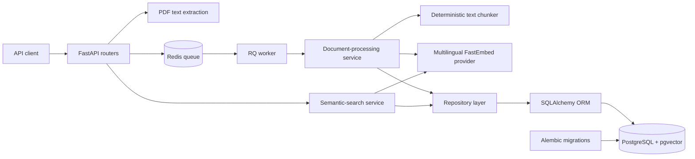
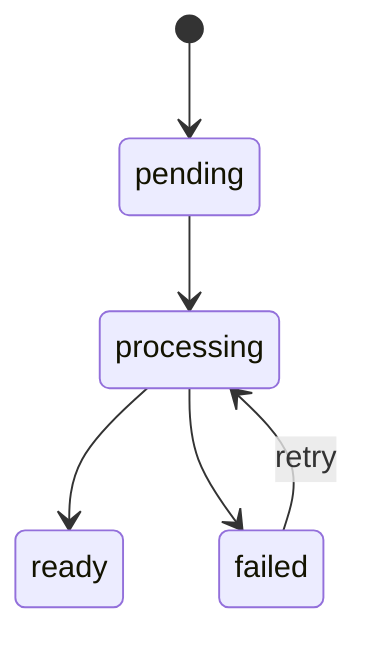

# KnowledgeOps API

[](https://github.com/fafnirkyu/knowledgeops-api/actions/workflows/ci.yml)

KnowledgeOps is a document-processing and semantic-search backend built with FastAPI, PostgreSQL, pgvector, Redis, RQ, SQLAlchemy, and Docker. It accepts text and PDF documents, processes uploads asynchronously, divides content into deterministic overlapping chunks, generates multilingual embeddings, and retrieves relevant passages with workspace-scoped cosine similarity search.

The current implementation provides the ingestion and retrieval foundation required for retrieval-augmented generation. It includes real local embedding inference and semantic retrieval; LLM-generated answers remain planned work.

## Features

- Workspace create, list, retrieve, partial update, and delete operations
- Document creation, workspace-scoped listing, and retrieval
- Text-based PDF upload and extraction with a 10 MiB size limit
- Asynchronous PDF processing with Redis and RQ
- Dedicated background worker with independent database sessions
- Document lifecycle states: `pending`, `processing`, `ready`, and `failed`
- Validated status transitions with failure reporting and retry support
- Deterministic overlapping text chunking with source offsets
- Persistent, ordered document chunks with database constraints
- Local multilingual embeddings with FastEmbed and a configurable 384-dimensional model
- PostgreSQL vector storage and cosine similarity search through pgvector
- Workspace-scoped semantic search with ranked similarity scores
- Reusable embedding-provider interface with a cached runtime implementation
- Direct document-processing endpoint for development and testing
- PostgreSQL persistence through SQLAlchemy 2.x
- Versioned database migrations with Alembic
- Typed environment configuration with Pydantic Settings
- Dockerized FastAPI, worker, Redis, and PostgreSQL development environment
- Automatic migrations during container startup
- Tests across schemas, models, repositories, services, and APIs
- GitHub Actions CI with PostgreSQL migration verification

## Architecture



The API layer validates HTTP requests and translates domain errors into appropriate responses. Services coordinate processing behavior, repositories handle persistence, and SQLAlchemy models define the database relationships and constraints.

## Document lifecycle



For PDF uploads, FastAPI extracts and validates the text, creates a `pending` document, enqueues only its UUID, and immediately returns `202 Accepted`. The RQ worker then creates its own database session and performs the following steps:

1. Transition the document from `pending` or `failed` to `processing`.
2. Split its content into deterministic overlapping chunks.
3. Generate one validated multilingual embedding for every chunk.
4. Persist each chunk with its index, source offsets, and vector.
5. Transition the document to `ready`.
6. On failure, roll back the active transaction, record the error, transition to `failed`, and re-raise the original exception.

## API endpoints

| Method | Path | Purpose |
| --- | --- | --- |
| `GET` | `/health` | Check API health |
| `POST` | `/workspaces` | Create a workspace |
| `GET` | `/workspaces` | List workspaces |
| `GET` | `/workspaces/{workspace_id}` | Retrieve one workspace |
| `PATCH` | `/workspaces/{workspace_id}` | Partially update a workspace |
| `DELETE` | `/workspaces/{workspace_id}` | Delete a workspace |
| `POST` | `/workspaces/{workspace_id}/documents` | Create a document in a workspace |
| `POST` | `/workspaces/{workspace_id}/documents/upload` | Upload a text-based PDF and enqueue background processing |
| `GET` | `/workspaces/{workspace_id}/documents` | List documents in a workspace |
| `GET` | `/documents/{document_id}` | Retrieve one document |
| `POST` | `/documents/{document_id}/process` | Process and persist document chunks |
| `POST` | `/workspaces/{workspace_id}/search` | Retrieve semantically similar chunks within a workspace |

Interactive OpenAPI documentation is available at `http://127.0.0.1:8000/docs` while the application is running.

## Quick start with Docker

Requirements:

- Docker Desktop or Docker Engine with Compose
- Git

Create the local environment file:

```powershell
Copy-Item .env.example .env
```

On macOS or Linux:

```bash
cp .env.example .env
```

Build and start the API, worker, Redis, and PostgreSQL:

```bash
docker compose up --build -d
```

Compose waits for PostgreSQL and Redis to become healthy, applies all Alembic migrations, starts Uvicorn on port `8000`, and runs an RQ worker for the `document-processing` queue.

The first processing or search request downloads the configured FastEmbed model. The default multilingual model is approximately 250 MB and is cached for later use.

Check the running services:

```bash
docker compose ps
```

Open the API documentation at `http://127.0.0.1:8000/docs`, or check API health:

```bash
curl http://127.0.0.1:8000/health
```

Stop the containers while preserving PostgreSQL data:

```bash
docker compose down
```

To also remove the local PostgreSQL and Redis volumes, use `docker compose down -v`.

## Example workflow

Using the interactive documentation, the asynchronous PDF workflow is:

1. Create a workspace with `POST /workspaces`.
2. Upload a text-based PDF with `POST /workspaces/{workspace_id}/documents/upload`.
3. Receive `202 Accepted` with the new document in the `pending` state.
4. Poll `GET /documents/{document_id}` until the worker changes its status to `ready` or `failed`.
5. Search the workspace with `POST /workspaces/{workspace_id}/search` and a JSON body containing `query` and `limit`.

The upload endpoint accepts text-based PDFs up to 10 MiB. Encrypted, malformed, scanned, and text-empty PDFs are rejected; OCR remains planned work. New documents begin in the `pending` state, and clients cannot directly set `status` or `processing_error`.

The JSON document endpoint and direct processing endpoint remain available for development, testing, and programmatic text ingestion.

Example search body:

```json
{
  "query": "How do I reset my password?",
  "limit": 5
}
```

## Local development without the API container

Create and activate a Python 3.10 virtual environment, then install dependencies:

```powershell
py -3.10 -m venv .venv
.\.venv\Scripts\Activate.ps1
python -m pip install -r requirements.txt
```

Create `.env`, start PostgreSQL and Redis, and apply migrations:

```powershell
Copy-Item .env.example .env
docker compose up -d db redis
alembic upgrade head
```

Start the development server:

```powershell
uvicorn app.main:app --reload
```

In a second terminal with the virtual environment active, start the worker:

```powershell
rq worker document-processing --url redis://localhost:6379/0
```

Run the complete test suite:

```powershell
python -m pytest -q
```

## Project structure

```text
app/
  core/          Environment configuration
  db/            SQLAlchemy engine, session, and dependencies
  jobs/          Redis queue configuration and background jobs
  models/        ORM models and relationships
  repositories/  Persistence operations and status transitions
  routers/       FastAPI endpoints
  schemas/       Pydantic request and response models
  services/      Chunking, embeddings, processing, and semantic-search workflows
alembic/         Versioned PostgreSQL migrations
tests/           Schema, model, repository, service, and API tests
.github/         GitHub Actions CI workflow
compose.yaml     Local API, worker, Redis, and PostgreSQL orchestration
Dockerfile       API container image
```

## Testing and CI

The test suite uses isolated in-memory SQLite databases for fast application tests. PostgreSQL-specific integration coverage runs against PostgreSQL 17 with pgvector, applies the complete Alembic migration history, and verifies real vector ranking plus workspace isolation.

Every push and pull request runs the CI workflow automatically.

## Design decisions

- **Explicit lifecycle transitions:** Invalid document states are rejected instead of silently overwritten.
- **Deterministic chunking:** Character-based windows make results repeatable and keep offsets aligned with the original source.
- **Source offsets:** Every stored chunk can be traced back to its exact location in the document.
- **Provider abstraction:** Processing and search depend on an embedding protocol rather than a specific model implementation.
- **Multilingual local inference:** The default FastEmbed model supports Portuguese and English without requiring a paid external API.
- **Cached model lifecycle:** FastAPI reuses one provider instance instead of loading the embedding model for every request.
- **Workspace-scoped retrieval:** Vector queries filter by workspace before ranking results, preventing cross-workspace leakage.
- **Layered responsibilities:** Routers handle HTTP, services coordinate workflows, and repositories own persistence.
- **Serializable background jobs:** Redis receives only document UUIDs; workers create their own database sessions and load current state from PostgreSQL.
- **Asynchronous upload contract:** PDF uploads return `202 Accepted` instead of holding an HTTP connection open during embedding inference.
- **Queue-failure cleanup:** If enqueueing fails after document creation, the pending row is removed and the API returns `503 Service Unavailable`.
- **Portable tests plus PostgreSQL verification:** SQLite keeps most tests fast, while CI exercises migrations and real pgvector operators.

## Roadmap

- OCR for scanned PDFs and additional file formats
- URL ingestion
- Retrieval responses with document metadata and citations
- RAG answer generation, grounding, and evaluation
- Authentication and workspace ownership
- Observability, structured logging, and processing metrics
- Cloud deployment
