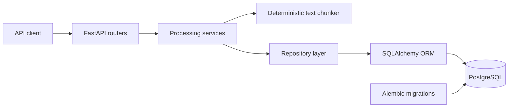
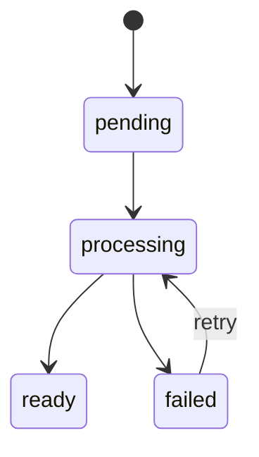

# KnowledgeOps API

[](https://github.com/fafnirkyu/knowledgeops-api/actions/workflows/ci.yml)

KnowledgeOps is a document-processing backend built with FastAPI, PostgreSQL, SQLAlchemy, and Docker. It organizes documents into workspaces, tracks their processing lifecycle, divides content into deterministic overlapping chunks, and preserves source offsets for future retrieval and citation features.

The current release focuses on the ingestion foundation required for semantic search and retrieval-augmented generation. Embeddings, vector search, and LLM-generated answers are planned rather than presented as completed features.

## Features

- Workspace create, list, retrieve, partial update, and delete operations
- Document creation, workspace-scoped listing, and retrieval
- Document lifecycle states: `pending`, `processing`, `ready`, and `failed`
- Validated status transitions with failure reporting and retry support
- Deterministic overlapping text chunking with source offsets
- Persistent, ordered document chunks with database constraints
- Synchronous document-processing endpoint
- PostgreSQL persistence through SQLAlchemy 2.x
- Versioned database migrations with Alembic
- Typed environment configuration with Pydantic Settings
- Dockerized FastAPI and PostgreSQL development environment
- Automatic migrations during container startup
- Tests across schemas, models, repositories, services, and APIs
- GitHub Actions CI with PostgreSQL migration verification

## Architecture



The API layer validates HTTP requests and translates domain errors into appropriate responses. Services coordinate processing behavior, repositories handle persistence, and SQLAlchemy models define the database relationships and constraints.

## Document lifecycle



Processing performs the following steps:

1. Transition the document from `pending` or `failed` to `processing`.
2. Split its content into deterministic overlapping chunks.
3. Persist each chunk with its index and source offsets.
4. Transition the document to `ready`.
5. On failure, roll back the active transaction, record the error, transition to `failed`, and re-raise the original exception.

## API endpoints

| Method | Path | Purpose |
| --- | --- | --- |
| `GET` | `/health` | Check API health |
| `POST` | `/workspaces` | Create a workspace |
| `GET` | `/workspaces` | List workspaces |
| `GET` | `/workspaces/{workspace_id}` | Retrieve one workspace |
| `PATCH` | `/workspaces/{workspace_id}` | Partially update a workspace |
| `DELETE` | `/workspaces/{workspace_id}` | Delete a workspace |
| `POST` | `/workspaces/{workspace_id}/documents` | Create a document in a workspace |
| `GET` | `/workspaces/{workspace_id}/documents` | List documents in a workspace |
| `GET` | `/documents/{document_id}` | Retrieve one document |
| `POST` | `/documents/{document_id}/process` | Process and persist document chunks |

Interactive OpenAPI documentation is available at `http://127.0.0.1:8000/docs` while the application is running.

## Quick start with Docker

Requirements:

- Docker Desktop or Docker Engine with Compose
- Git

Create the local environment file:

```powershell
Copy-Item .env.example .env
```

On macOS or Linux:

```bash
cp .env.example .env
```

Build and start the API and PostgreSQL:

```bash
docker compose up --build -d
```

Compose waits for PostgreSQL to become healthy, applies all Alembic migrations, and then starts Uvicorn on port `8000`.

Check the running services:

```bash
docker compose ps
```

Open the API documentation at `http://127.0.0.1:8000/docs`, or check API health:

```bash
curl http://127.0.0.1:8000/health
```

Stop the containers while preserving PostgreSQL data:

```bash
docker compose down
```

To also remove the local database volume, use `docker compose down -v`.

## Example workflow

Using the interactive documentation:

1. Create a workspace with `POST /workspaces`.
2. Create a document with `POST /workspaces/{workspace_id}/documents`.
3. Process it with `POST /documents/{document_id}/process`.
4. Retrieve the document and confirm that its status is `ready`.

New documents begin in the `pending` state. Processing is controlled by the server; clients cannot directly set `status` or `processing_error`.

## Local development without the API container

Create and activate a Python 3.10 virtual environment, then install dependencies:

```powershell
py -3.10 -m venv .venv
.\.venv\Scripts\Activate.ps1
python -m pip install -r requirements.txt
```

Create `.env`, start only PostgreSQL, and apply migrations:

```powershell
Copy-Item .env.example .env
docker compose up -d db
alembic upgrade head
```

Start the development server:

```powershell
uvicorn app.main:app --reload
```

Run the complete test suite:

```powershell
python -m pytest -q
```

## Project structure

```text
app/
  core/          Environment configuration
  db/            SQLAlchemy engine, session, and dependencies
  models/        ORM models and relationships
  repositories/  Persistence operations and status transitions
  routers/       FastAPI endpoints
  schemas/       Pydantic request and response models
  services/      Text chunking and document-processing workflows
alembic/         Versioned PostgreSQL migrations
tests/           Schema, model, repository, service, and API tests
.github/         GitHub Actions CI workflow
compose.yaml     Local API and PostgreSQL orchestration
Dockerfile       API container image
```

## Testing and CI

The test suite uses isolated in-memory SQLite databases for fast application tests. CI also starts PostgreSQL 17 and applies the full Alembic migration history, ensuring that the production database schema can be created from an empty database.

Every push and pull request runs the CI workflow automatically.

## Design decisions

- **Explicit lifecycle transitions:** Invalid document states are rejected instead of silently overwritten.
- **Deterministic chunking:** Character-based windows make results repeatable and keep offsets aligned with the original source.
- **Source offsets:** Every stored chunk can be traced back to its exact location in the document.
- **Layered responsibilities:** Routers handle HTTP, services coordinate workflows, and repositories own persistence.
- **Synchronous v0.1 processing:** The initial release keeps execution observable and testable before introducing background workers.
- **Portable tests plus PostgreSQL verification:** SQLite keeps application tests fast, while CI verifies real PostgreSQL migrations.

## Roadmap

- Background document-processing workers
- File and URL ingestion
- Embeddings and PostgreSQL vector search
- Semantic retrieval with citations
- RAG answer generation and evaluation
- Authentication and workspace ownership
- Observability, structured logging, and processing metrics
- Cloud deployment
